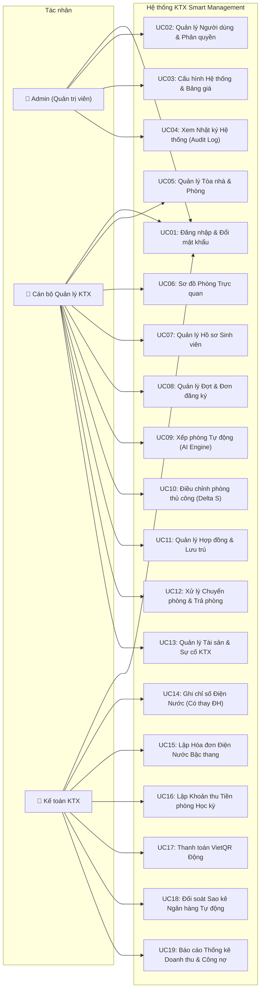
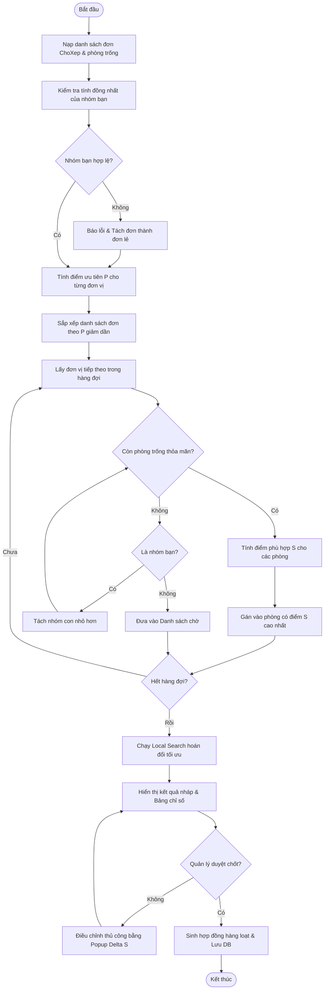
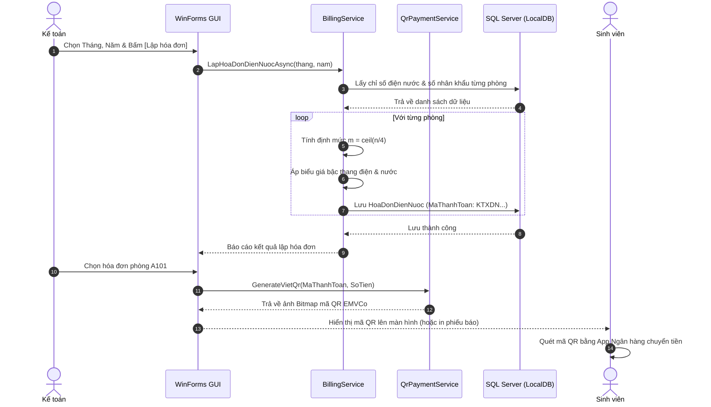

# HỒ SƠ PHÂN TÍCH VÀ THIẾT KẾ HỆ THỐNG (PHASE 1)
**Đề tài:** Hệ thống Quản lý Ký túc xá Thông minh (KTX Smart Management)  
**Nền tảng:** C# WinForms (.NET 10), SQL Server, Entity Framework Core 10  
**Tác giả:** Nguyễn Huyền My  
**Học phần:** Đồ án / Bài tập lớn Lập trình .NET  

---

## 1. PHÁT BIỂU BÀI TOÁN VÀ KHẢO SÁT NGHIỆP VỤ (Task 1.1)

### 1.1 Thực trạng và vấn đề tại các Ký túc xá đại học
Hiện nay, công tác quản lý tại các Ký túc xá sinh viên phần lớn vẫn thực hiện thủ công hoặc sử dụng bảng tính Excel rời rạc, dẫn đến các bất cập nghiêm trọng:
1. **Xếp phòng thủ công quá tải:** Mỗi đầu năm học, hàng ngàn sinh viên nộp đơn đăng ký. Cán bộ quản lý phải dò tay từng đơn, cân đối giới tính, khoa, khóa, nguyện vọng ở cùng nhóm bạn và đối tượng ưu tiên chính sách. Quá trình này mất từ 2-3 tuần, dễ nhầm lẫn và thiếu tính minh bạch.
2. **Xung đột tài chính giữa "Tiền phòng" và "Tiền điện nước":** 
   - Tiền phòng gắn liền với từng cá nhân sinh viên (hợp đồng riêng, chính sách miễn giảm riêng theo đối tượng ưu tiên, thời điểm nhận/trả phòng khác nhau).
   - Tiền điện nước và dịch vụ là tiêu thụ chung của cả tập thể phòng. Việc gộp chung làm kế toán không thể đối soát ai đang nợ khi có sinh viên chuyển phòng giữa kỳ.
3. **Tính toán điện nước bậc thang phức tạp:** Giá điện EVN và nước sinh hoạt áp dụng biểu giá lũy tiến bậc thang và có quy định về **định mức theo số nhân khẩu thực tế** (cứ 4 sinh viên tính 1 định mức hộ gia đình). Tính tay cho hàng trăm phòng dẫn đến sai số cao.
4. **Đối soát giao dịch ngân hàng chậm trễ:** Sinh viên chuyển khoản ngân hàng nhưng kế toán phải đối chiếu từng dòng sao kê trên điện thoại hoặc file Excel thủ công để gạch nợ.

### 1.2 Mục tiêu của hệ thống KTX Smart Management
* **Tự động hóa phân bổ phòng (Auto-Matching Algorithm):** Sử dụng thuật toán kết hợp Greedy + Local Search để xếp tự động hàng trăm đơn đăng ký vào các phòng trống trong vòng dưới 3 giây, tối đa hóa nguyện vọng và giữ nguyên vẹn các nhóm bạn.
* **Tách bạch 2 dòng tiền tài chính:** Quản lý độc lập *Khoản thu tiền phòng (theo Hợp đồng sinh viên)* và *Hóa đơn điện nước (theo Phòng hàng tháng)*.
* **Tự động tính lũy tiến bậc thang & Xử lý thay đồng hồ:** Tự động nhân hệ số định mức $m = \lceil \text{Số người}/4 \rceil$, tính đúng biểu giá và hỗ trợ nghiệp vụ thay đồng hồ chập cháy mà không làm sai lệch số liệu.
* **Thanh toán VietQR động & Tự động đối soát sao kê:** Tạo mã QR chuẩn EMVCo gắn số tiền và mã hóa đơn; đọc file sao kê Excel và tự động gạch nợ thông qua thuật toán băm kép (Double Hashing) chống trùng lặp.
* **Giao diện hiện đại (Modern UI):** Thiết kế phẳng Fluent/Windows 11, hỗ trợ Dark/Light mode, sơ đồ phòng trực quan, không giật lag.

---

## 2. MÔ HÌNH HÓA USE CASE HỆ THỐNG (Task 1.2)

### 2.1 Sơ đồ Use Case Tổng quát

---

## 3. ĐẶC TẢ CHI TIẾT CÁC USE CASE CỐT LÕI (Task 1.3)

### 3.1 Use Case UC09: Xếp phòng Tự động (Auto-Matching)
* **Tác nhân chính:** Cán bộ Quản lý KTX.
* **Tiền điều kiện:** 
  - Đợt đăng ký đã đóng, tồn tại danh sách đơn đăng ký ở trạng thái `ChoXep`.
  - Hệ thống có các phòng đang hoạt động (`HoatDong`) và còn chỗ trống.
* **Hậu điều kiện:**
  - Tạo phiên xếp phòng (`PhienXepPhong`) ở trạng thái nháp (`DaChot = false`).
  - Toàn bộ sinh viên được gán vào phòng tối ưu hoặc đưa vào danh sách chờ (`DanhSachCho`).
* **Luồng sự kiện chính:**
  1. Quản lý chọn đợt đăng ký cần xếp phòng và cấu hình trọng số ưu tiên ($w_1..w_6$).
  2. Bấm nút **[Bắt đầu Xếp phòng]**.
  3. Hệ thống nạp danh sách đơn và danh sách phòng trống vào bộ nhớ RAM.
  4. Hệ thống kiểm tra tính hợp lệ của các nhóm bạn (cùng giới tính, không vượt sức chứa).
  5. Thuật toán Greedy gom nhóm, sắp xếp theo điểm ưu tiên $P$, tìm phòng có điểm phù hợp $S$ cao nhất.
  6. Thuật toán Local Search tiến hành đổi chỗ cục bộ để tối ưu hóa tổng điểm toàn hệ thống.
  7. Hệ thống hiển thị kết quả lên giao diện trực quan kèm bảng thống kê chỉ số: Tỷ lệ xếp thành công, Tỷ lệ giữ nguyên nhóm bạn, Thời gian thực thi.
* **Luồng rẽ nhánh / Ngoại lệ:**
  - *Nhóm bạn không vừa phòng trống nào:* Hệ thống tự động phân rã nhóm thành các nhóm con nhỏ nhất và ghi nhận cảnh báo tách nhóm.
  - *Hết phòng hợp lệ:* Chuyển trạng thái đơn sang `DanhSachCho`.

---

### 3.2 Use Case UC15: Lập Hóa đơn Điện Nước Bậc thang theo Định mức
* **Tác nhân chính:** Kế toán KTX.
* **Tiền điều kiện:** Các phòng đã được nhập chỉ số điện nước tháng hiện tại (`ChiSoDienNuoc`).
* **Hậu điều kiện:** Sinh ra hóa đơn điện nước (`HoaDonDienNuoc`) kèm mã thanh toán duy nhất (`KTXDNxxxxxx`).
* **Luồng sự kiện chính:**
  1. Kế toán chọn Tháng và Năm cần lập hóa đơn, chọn Tòa nhà (hoặc toàn bộ KTX).
  2. Bấm **[Lập hóa đơn hàng loạt]**.
  3. Với mỗi phòng, hệ thống xác định:
     - Số nhân khẩu thực tế đang ở tại thời điểm chốt chỉ số.
     - Tính hệ số định mức: $m = \lceil \text{Số nhân khẩu} / 4 \rceil$.
     - Tính sản lượng điện và nước thực tế tiêu thụ trong tháng (xử lý cờ `CoThayDongHo`).
     - Chia sản lượng vào từng bậc giá tương ứng nhân với đơn giá quy định.
     - Tính thuế VAT (8%).
  4. Hệ thống tạo bản ghi `HoaDonDienNuoc` với mã chuyển khoản duy nhất `KTXDN000xxx`, trạng thái `ChuaThanhToan`.
  5. Cảnh báo các phòng có sản lượng tăng đột biến > 150% so với trung bình 3 tháng gần nhất.

---

### 3.3 Use Case UC18: Đối soát Sao kê Ngân hàng Tự động
* **Tác nhân chính:** Kế toán KTX.
* **Tiền điều kiện:** Kế toán có file Excel sao kê ngân hàng tải từ Internet Banking.
* **Hậu điều kiện:** Các hóa đơn khớp tiền chuyển sang trạng thái `DaThanhToan` và lưu lịch sử `ThanhToan`.
* **Luồng sự kiện chính:**
  1. Kế toán chọn file Excel sao kê ngân hàng và bấm **[Tải lên & Đối soát]**.
  2. Hệ thống đọc từng dòng trong file Excel:
     - Tạo mã băm duy nhất: $\text{Hash} = \text{SHA256}(\text{NgayGD} + \text{SoTien} + \text{NoiDungGoc} + \text{SoDuSau})$.
     - Kiểm tra trong bảng `GiaoDichNganHang`: Nếu mã Hash đã tồn tại $\rightarrow$ Bỏ qua (Chống nạp trùng).
  3. Phân tích nội dung chuyển khoản bằng biểu thức chính quy (Regex):
     - Khớp mẫu `KTXDN(\d+)`: Tìm hóa đơn điện nước tương ứng.
     - Khớp mẫu `KTXTP(\d+)`: Tìm khoản thu tiền phòng tương ứng.
  4. So khớp số tiền:
     - Số tiền chuyển $\ge$ Số tiền phải thu: Cập nhật hóa đơn `DaThanhToan`, tạo bản ghi `ThanhToan` (Nguồn: SaoKe).
     - Số tiền chuyển $<$ Số tiền phải thu: Cập nhật `ThanhToanMotPhan`.
     - Không tìm thấy mã hóa đơn: Đưa vào danh sách `CanXuLy` để kế toán duyệt tay.
  5. Hiển thị báo cáo kết quả đối soát trên 3 Tab (Đã khớp, Thu một phần, Cần xử lý).

---

## 4. SƠ ĐỒ HOẠT ĐỘNG VÀ SƠ ĐỒ TUẦN TỰ (Task 1.4)

### 4.1 Activity Diagram: Quy trình Xếp phòng Tự động

---

### 4.2 Sequence Diagram: Quy trình Lập Hóa đơn & Thanh toán VietQR

---

## 5. TỪ ĐIỂN DỮ LIỆU CHI TIẾT - DATA DICTIONARY (Task 1.5)

Hệ thống được thiết kế chuẩn hóa mức 3NF, bao gồm **26 bảng dữ liệu**:

### Nhóm 1: Cơ sở vật chất (Facility)
1. **`ToaNha` (Tòa nhà KTX):**
   - `Id` (INT, PK, Identity): Mã định danh tòa nhà.
   - `Ten` (NVARCHAR(100), Not Null): Tên tòa (Tòa A, Tòa B...).
   - `GioiTinh` (INT, Enum): Giới tính quy định (1 = Nam, 2 = Nữ).
   - `SoTang` (INT, Not Null): Số lượng tầng của tòa nhà.

2. **`LoaiPhong` (Loại phòng lưu trú):**
   - `Id` (INT, PK, Identity): Mã loại phòng.
   - `Ten` (NVARCHAR(100), Not Null): Tên loại phòng (Phòng 4 người ĐH, Phòng 6 người...).
   - `SucChua` (INT, Not Null): Số lượng sinh viên tối đa (4, 6, 8).
   - `GiaThang` (DECIMAL(18,2), Not Null): Đơn giá thuê/tháng/sinh viên.
   - `CoDieuHoa` (BIT, Not Null): Có điều hòa nhiệt độ hay không.

3. **`Phong` (Phòng KTX):**
   - `Id` (INT, PK, Identity): Mã phòng nội bộ.
   - `MaPhong` (NVARCHAR(50), UK with ToaId): Ký hiệu phòng (A101, B205...).
   - `ToaId` (INT, FK -> ToaNha.Id): Thuộc tòa nhà nào.
   - `Tang` (INT, Not Null): Tầng số mấy.
   - `LoaiPhongId` (INT, FK -> LoaiPhong.Id): Thuộc loại phòng nào.
   - `TrangThai` (INT, Enum): Trạng thái phòng (1 = HoatDong, 2 = BaoTri).
   - `RowVersion` (ROWVERSION/TIMESTAMP): Token kiểm soát tranh chấp đồng thời (Optimistic Concurrency).

4. **`TaiSanPhong` (Tài sản bàn giao trong phòng):**
   - `Id` (INT, PK, Identity): Mã tài sản.
   - `PhongId` (INT, FK -> Phong.Id): Đặt tại phòng nào.
   - `TenTaiSan` (NVARCHAR(150)): Giường tầng, Bàn học, Điều hòa...
   - `SoLuong` (INT, Default 1): Số lượng trang bị.
   - `TinhTrang` (NVARCHAR(100)): Tình trạng sử dụng ("Tốt", "Cần bảo dưỡng").

---

### Nhóm 2: Sinh viên & Địa phương (Student & Priority)
5. **`TinhThanh` (34 Tỉnh/Thành phố hiện hành theo NQ sắp xếp):**
   - `Id` (INT, PK, Identity): Mã tỉnh thành.
   - `Ten` (NVARCHAR(100), Not Null): Tên tỉnh/thành phố chuẩn hóa.
   - `KhoangCachKm` (INT, Not Null): Khoảng cách tính từ KTX/Trường học.
   - `NhomKhoangCach` (INT): Phân nhóm điểm ưu tiên (1: <100km, 2: 100-300km, 3: >300km).

6. **`TinhThanhCu` (Bảng ánh xạ 63 tỉnh thành cũ):**
   - `Id` (INT, PK, Identity): Mã định danh.
   - `TenCu` (NVARCHAR(100), Not Null): Tên tỉnh thành trước sáp nhập (Hà Tây, Hà Bắc...).
   - `TinhThanhId` (INT, FK -> TinhThanh.Id): Ánh xạ về tỉnh thành mới nào.

7. **`DienUuTien` (Danh mục diện ưu tiên chính sách):**
   - `Id` (INT, PK, Identity): Mã diện ưu tiên.
   - `Ten` (NVARCHAR(200)): Con thương binh liệt sĩ, Hộ nghèo, Vùng sâu...
   - `DiemCong` (INT): Số điểm ưu tiên cộng thêm vào thuật toán xếp phòng.

8. **`SinhVien` (Hồ sơ Sinh viên):**
   - `MSSV` (NVARCHAR(20), PK): Mã số sinh viên.
   - `HoTen` (NVARCHAR(150), Not Null): Họ và tên đầy đủ.
   - `NgaySinh` (DATETIME, Not Null): Ngày tháng năm sinh.
   - `GioiTinh` (INT, Enum): 1 = Nam, 2 = Nữ.
   - `CCCD` (NVARCHAR(20), UK): Số Căn cước công dân gắn chip.
   - `Khoa` (NVARCHAR(100)): Khoa đào tạo (CNTT, DTVT...).
   - `KhoaHoc` (INT): Khóa sinh viên (K67, K68...).
   - `SoDienThoai` (NVARCHAR(20)): Số điện thoại liên hệ.
   - `Email` (NVARCHAR(150)): Email sinh viên.
   - `TinhThanhId` (INT, FK -> TinhThanh.Id): Quê quán.
   - `DienUuTienId` (INT, FK -> DienUuTien.Id, Nullable): Thuộc diện ưu tiên nào.

---

### Nhóm 3: Đăng ký & Xếp phòng (Registration & Allocation)
9. **`DotDangKy` (Đợt mở đăng ký KTX):**
   - `Id` (INT, PK, Identity): Mã đợt đăng ký.
   - `Ten` (NVARCHAR(150)): Tên đợt (Học kỳ 1 năm học 2026-2027).
   - `NgayMo` (DATETIME), `NgayDong` (DATETIME): Thời gian nhận đơn.
   - `DangMo` (BIT): Cờ trạng thái đợt đang mở hay đã đóng.

10. **`NhomDangKy` (Nhóm nguyện vọng ở cùng nhau):**
    - `Id` (INT, PK, Identity): Mã nhóm nội bộ.
    - `MaNhom` (NVARCHAR(50), UK): Ký hiệu nhóm (NHOM_001).
    - `MSSVTruongNhom` (NVARCHAR(20)): MSSV của bạn đại diện nhóm.

11. **`DonDangKy` (Đơn đăng ký lưu trú):**
    - `Id` (INT, PK, Identity): Mã đơn.
    - `MSSV` (NVARCHAR(20), FK -> SinhVien.MSSV): Sinh viên nộp đơn.
    - `DotId` (INT, FK -> DotDangKy.Id): Thuộc đợt nào.
    - `NhomId` (INT, FK -> NhomDangKy.Id, Nullable): Nhóm bạn cùng đăng ký.
    - `LoaiPhongMongMuonId` (INT, FK -> LoaiPhong.Id, Nullable): Nguyện vọng loại phòng.
    - `BatBuocLoaiPhong` (BIT): Có bắt buộc đúng loại phòng không.
    - `ToaMongMuonId` (INT, FK -> ToaNha.Id, Nullable): Nguyện vọng tòa nhà.
    - `TangMongMuon` (INT, Nullable): Nguyện vọng tầng.
    - `DiemUuTien` (DECIMAL(18,2)): Tổng điểm ưu tiên tính toán ($P$).
    - `ThoiGianNop` (DATETIME): Thời điểm gửi đơn.
    - `TrangThai` (INT, Enum): 1 = ChoXep, 2 = DaXep, 3 = DanhSachCho, 4 = Huy.

12. **`PhienXepPhong` (Lịch sử các lần chạy thuật toán):**
    - `Id` (INT, PK, Identity): Mã phiên xếp phòng.
    - `DotId` (INT, FK -> DotDangKy.Id): Chạy cho đợt nào.
    - `ThuatToan` (NVARCHAR(50)): "Greedy+LocalSearch" hoặc "OrTools".
    - `ThoiGian` (DATETIME): Thời điểm chạy.
    - `ThongKeJson` (NVARCHAR(MAX)): Dữ liệu thống kê JSON (tỷ lệ thành công, thời gian chạy).
    - `DaChot` (BIT): Phiên đã được quản lý duyệt chốt hay chưa.

13. **`ChiTietXepPhong` (Kết quả phân bổ đơn vào phòng):**
    - `Id` (INT, PK, Identity): Mã kết quả chi tiết.
    - `PhienId` (INT, FK -> PhienXepPhong.Id): Thuộc phiên nào.
    - `DonId` (INT, FK -> DonDangKy.Id): Đơn được xếp.
    - `PhongId` (INT, FK -> Phong.Id): Xếp vào phòng nào.
    - `DiemPhuHop` (DECIMAL(18,2)): Điểm thỏa mãn ($S$).
    - `ChinhTay` (BIT): Có bị cán bộ điều chỉnh thủ công không.

---

### Nhóm 4: Hợp đồng & Lưu trú (Contract & Stay)
14. **`HopDong` (Hợp đồng thuê phòng sinh viên):**
    - `Id` (INT, PK, Identity): Mã hợp đồng.
    - `MSSV` (NVARCHAR(20), FK -> SinhVien.MSSV): Sinh viên ký hợp đồng.
    - `PhongId` (INT, FK -> Phong.Id): Phòng được xếp ở.
    - `NgayBatDau` (DATETIME), `NgayKetThuc` (DATETIME): Thời hạn hợp đồng.
    - `GiaThang` (DECIMAL(18,2)): Giá thuê thỏa thuận/tháng.
    - `MienGiamPhanTram` (DECIMAL(18,2)): Tỷ lệ miễn giảm theo diện chính sách.
    - `TienCoc` (DECIMAL(18,2)): Tiền cọc cơ sở vật chất.
    - `TrangThai` (INT, Enum): 1 = HieuLuc, 2 = DaTra, 3 = Huy.
    - `RowVersion` (ROWVERSION): Token chống xung đột đồng thời.
    - *(Ràng buộc Unique Filtered Index trên `MSSV` khi `TrangThai = 1`: 1 sinh viên chỉ có tối đa 1 hợp đồng đang hiệu lực).*

15. **`LichSuChuyenPhong` (Nhật ký chuyển phòng):**
    - `Id` (INT, PK, Identity): Mã lần chuyển.
    - `HopDongId` (INT, FK -> HopDong.Id): Thuộc hợp đồng nào.
    - `TuPhongId` (INT, FK -> Phong.Id): Chuyển từ phòng cũ nào.
    - `DenPhongId` (INT, FK -> Phong.Id): Chuyển sang phòng mới nào.
    - `NgayChuyen` (DATETIME): Ngày thực hiện.
    - `LyDo` (NVARCHAR(250)): Lý do chuyển phòng.

---

### Nhóm 5: Tài chính & Thanh toán (Finance & Reconcile)
16. **`BacGia` (Biểu giá bậc thang điện nước):**
    - `Id` (INT, PK, Identity): Mã bậc giá.
    - `LoaiDichVu` (INT, Enum): 1 = Điện, 2 = Nước.
    - `Bac` (INT): Bậc số mấy (1..6 đối với điện, 1..4 đối với nước).
    - `TuMuc` (DECIMAL(18,2)), `DenMuc` (DECIMAL(18,2), Nullable): Khoảng sản lượng (kWh hoặc m3).
    - `DonGia` (DECIMAL(18,2)): Giá tiền cho 1 đơn vị.
    - `ApDungTu` (DATETIME): Ngày biểu giá có hiệu lực.

17. **`ChiSoDienNuoc` (Chỉ số đồng hồ điện nước hàng tháng):**
    - `Id` (INT, PK, Identity): Mã bản ghi.
    - `PhongId` (INT, FK -> Phong.Id): Ghi nhận tại phòng nào.
    - `Thang` (INT), `Nam` (INT): Kỳ hóa đơn.
    - `DienCu` (DECIMAL(18,2)), `DienMoi` (DECIMAL(18,2)): Chỉ số điện cũ và mới.
    - `CoThayDongHoDien` (BIT): Cờ đánh dấu có thay đồng hồ điện trong tháng không.
    - `DienChotDongHoCu` (DECIMAL(18,2), Nullable): Số chốt đồng hồ cũ trước khi tháo.
    - `DienDauDongHoMoi` (DECIMAL(18,2), Nullable): Số bắt đầu của đồng hồ mới lắp.
    - `SanLuongDien` (DECIMAL(18,2)): Sản lượng điện thực tế tiêu thụ trong tháng.
    - `NuocCu`, `NuocMoi`, `CoThayDongHoNuoc`, `NuocChotDongHoCu`, `NuocDauDongHoMoi`, `SanLuongNuoc`: Tương tự cho nước.
    - `GhiChu` (NVARCHAR(250)): Lý do thay đồng hồ hoặc ghi chú sự cố.

18. **`HoaDonDienNuoc` (Hóa đơn điện nước phòng hàng tháng):**
    - `Id` (INT, PK, Identity): Mã hóa đơn.
    - `MaThanhToan` (NVARCHAR(50), UK): Mã thanh toán chuyển khoản duy nhất (`KTXDN000123`).
    - `PhongId` (INT, FK -> Phong.Id): Hóa đơn của phòng nào.
    - `Thang` (INT), `Nam` (INT): Kỳ hóa đơn.
    - `SoNguoiTinhDinhMuc` (INT): Số nhân khẩu thực tế dùng để nhân bậc thang.
    - `TongTien` (DECIMAL(18,2)): Tổng số tiền phòng phải trả.
    - `DaThu` (DECIMAL(18,2)): Số tiền đã thanh toán.
    - `TrangThai` (INT, Enum): 1 = ChuaThanhToan, 2 = ThanhToanMotPhan, 3 = DaThanhToan.

19. **`ChiTietHoaDon` (Bóc tách chi tiết từng khoản trong hóa đơn):**
    - `Id` (INT, PK, Identity): Mã chi tiết.
    - `HoaDonId` (INT, FK -> HoaDonDienNuoc.Id): Thuộc hóa đơn nào.
    - `NoiDung` (NVARCHAR(150)): "Điện bậc 1", "Điện bậc 2", "Thuế VAT 8%"...
    - `SoLuong` (DECIMAL(18,2)), `DonGia` (DECIMAL(18,2)), `ThanhTien` (DECIMAL(18,2)).

20. **`KhoanThuTienPhong` (Khoản thu tiền phòng theo sinh viên):**
    - `Id` (INT, PK, Identity): Mã khoản thu.
    - `MaThanhToan` (NVARCHAR(50), UK): Mã thanh toán chuyển khoản duy nhất (`KTXTP000045`).
    - `HopDongId` (INT, FK -> HopDong.Id): Thuộc hợp đồng của sinh viên nào.
    - `TuNgay` (DATETIME), `DenNgay` (DATETIME): Khoảng thời gian thu tiền.
    - `SoTienGoc` (DECIMAL(18,2)): Tiền phòng nguyên giá.
    - `MienGiam` (DECIMAL(18,2)): Số tiền được miễn giảm theo diện chính sách.
    - `PhaiThu` (DECIMAL(18,2)): Số tiền thực tế sinh viên phải nộp.
    - `DaThu` (DECIMAL(18,2)): Số tiền sinh viên đã thanh toán.
    - `TrangThai` (INT, Enum): 1 = ChuaThanhToan, 2 = ThanhToanMotPhan, 3 = DaThanhToan.

21. **`GiaoDichNganHang` (Lịch sử các dòng sao kê ngân hàng import vào):**
    - `Id` (INT, PK, Identity): Mã giao dịch.
    - `NgayGD` (DATETIME): Thời điểm chuyển khoản trên sao kê.
    - `SoTien` (DECIMAL(18,2)): Số tiền ghi có (+).
    - `NoiDungGoc` (NVARCHAR(500)): Nội dung chuyển khoản nguyên văn.
    - `MaGiaoDich` (NVARCHAR(100), UK Filtered): Mã bút toán ngân hàng (nếu có).
    - `SoDuSau` (DECIMAL(18,2), Nullable): Số dư tài khoản sau giao dịch.
    - `HashSaoKe` (NVARCHAR(64), UK): Mã băm SHA-256 chống import trùng.
    - `TrangThaiKhop` (INT, Enum): 1 = DaKhop, 2 = CanXuLy, 3 = BoQua.
    - `FileNguon` (NVARCHAR(200)): Tên file sao kê đã import.
    - `NgayImport` (DATETIME): Thời điểm import vào hệ thống.

22. **`ThanhToan` (Bản ghi phiếu thu tiền):**
    - `Id` (INT, PK, Identity): Mã phiếu thu.
    - `HoaDonDienNuocId` (INT, FK -> HoaDonDienNuoc.Id, Nullable): Gạch nợ cho hóa đơn điện nước nào.
    - `KhoanThuTienPhongId` (INT, FK -> KhoanThuTienPhong.Id, Nullable): Gạch nợ cho khoản thu tiền phòng nào.
    - `GiaoDichNganHangId` (INT, FK -> GiaoDichNganHang.Id, Nullable): Nguồn gốc từ dòng sao kê nào.
    - `SoTien` (DECIMAL(18,2)): Số tiền thu được.
    - `HinhThuc` (INT, Enum): 1 = TienMat, 2 = ChuyenKhoan.
    - `ThoiGian` (DATETIME): Thời điểm lập phiếu thu.
    - `NguoiThuId` (INT, FK -> NguoiDung.Id): Cán bộ/Kế toán thực hiện thu tiền.

---

### Nhóm 6: Quản trị & Hệ thống (System & Admin)
23. **`VaiTro` (Vai trò người dùng):**
    - `Id` (INT, PK): 1 = Admin, 2 = QuanLy, 3 = KeToan.
    - `TenVaiTro` (NVARCHAR(50)): Tên vai trò.

24. **`NguoiDung` (Tài khoản cán bộ):**
    - `Id` (INT, PK, Identity): Mã người dùng.
    - `TenDangNhap` (NVARCHAR(50), UK): Tên đăng nhập.
    - `MatKhauHash` (NVARCHAR(250)): Mật khẩu đã băm bằng BCrypt (Salt tự động).
    - `HoTen` (NVARCHAR(150)): Họ tên cán bộ.
    - `MaVaiTro` (INT, FK -> VaiTro.Id): Quyền hạn.
    - `HoatDong` (BIT): Đang hoạt động hay bị khóa.
    - `SoLanSai` (INT): Số lần đăng nhập sai liên tiếp.
    - `KhoaDen` (DATETIME, Nullable): Thời điểm hết hạn tạm khóa tài khoản.

25. **`NhatKy` (Nhật ký kiểm toán - Audit Log):**
    - `Id` (BIGINT, PK, Identity): Mã nhật ký.
    - `NguoiDungId` (INT, FK -> NguoiDung.Id, Nullable): Cán bộ thao tác.
    - `HanhDong` (NVARCHAR(100)): "Đăng nhập", "Thêm mới", "Cập nhật", "Xóa".
    - `ChiTiet` (NVARCHAR(MAX)): Mô tả chi tiết hành động.
    - `BangLienQuan` (NVARCHAR(100)): Bảng dữ liệu bị tác động.
    - `KhoaChinhLienQuan` (NVARCHAR(50)): Khóa chính bản ghi bị tác động.
    - `ThoiGian` (DATETIME): Thời điểm xảy ra sự kiện.

26. **`CauHinh` (Tham số hệ thống):**
    - `Id` (INT, PK, Identity): Mã tham số.
    - `Khoa` (NVARCHAR(100), UK): Khóa cấu hình (`BankBin`, `BankAccount`, `VatRate`...).
    - `GiaTri` (NVARCHAR(MAX)): Giá trị cấu hình.
    - `MoTa` (NVARCHAR(250)): Giải thích ý nghĩa tham số.

---

## 6. ĐẶC TẢ GIAO DIỆN & DESIGN SYSTEM (Task 1.6 & 1.7)

### 6.1 Bảng mã màu Design Tokens (Đã áp dụng trong `KTX.UI`)
| Token | Chức năng | Light Mode (Hex) | Dark Mode (Hex) |
|---|---|---|---|
| `Background` | Nền toàn bộ Form | `#F5F7FB` | `#0F1115` |
| `Surface` | Nền Sidebar, Topbar | `#FFFFFF` | `#181B21` |
| `SurfaceCard` | Nền các thẻ Card, Khung bảng | `#FFFFFF` | `#181B21` |
| `Border` | Đường viền ngăn cách (1px) | `#E3E8EF` | `#2A2F38` |
| `Primary` | Màu thương hiệu chính | `#2563EB` | `#3B82F6` |
| `PrimaryLight` | Màu nền nút/menu đang chọn | `#EFF6FF` | `#1E293B` |
| `Success` | Màu trạng thái Đã thanh toán, Hoạt động | `#16A34A` | `#22C55E` |
| `Warning` | Màu trạng thái Thu một phần, Cảnh báo | `#F59E0B` | `#FBBF24` |
| `Danger` | Màu trạng thái Chưa thanh toán, Bảo trì | `#DC2626` | `#EF4444` |

### 6.2 Nguyên tắc thiết kế UI/UX
* **Hạn chế nháy hình (Flicker-Free):** Mọi control đều bật `DoubleBuffered = true` và `OptimizedDoubleBuffer`.
* **Sơ đồ phòng trực quan (Room Map):** Một control tự vẽ (Owner-drawn) duy nhất cho mỗi tầng, hiển thị ô phòng với mã phòng, tỷ lệ người (vd: `4/6`), thanh tiến trình lấp đầy và màu sắc phân loại:
  - 🟢 **Xanh lá:** Phòng còn trống 100%.
  - 🟠 **Cam:** Phòng đang ở một phần (còn chỗ).
  - 🔴 **Đỏ:** Phòng đã đầy đủ người.
  - ⚪ **Xám:** Phòng đang bảo trì.
* **Hỗ trợ máy chiếu (DPI Scaling):** Chuẩn hóa chế độ hiển thị `PerMonitorV2`, font chữ Segoe UI Variable sắc nét ở mọi tỷ lệ phóng to 100%, 125%, 150%.
